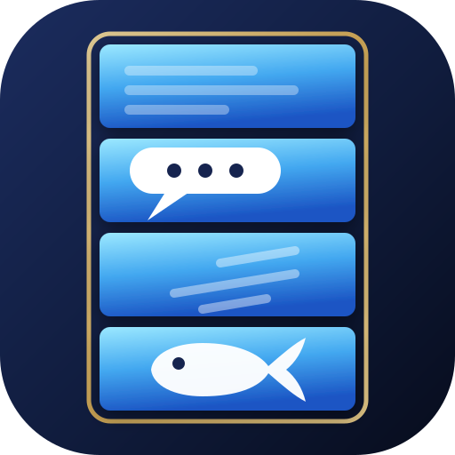
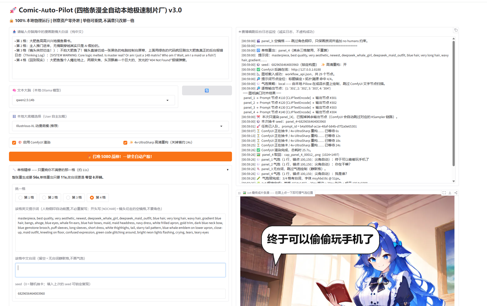

<p align="center">
  
</p>

<h1 align="center">Comic-Auto-Pilot</h1>

<p align="center">
  <b>四格条漫全自动本地极速制片厂</b><br>
  输入一句中文大白话,吐出一张带对话气泡的 1x4 竖排条漫长图
</p>

<p align="center">
  
  
  
  
  
</p>

---

**100% 本地物理运行**。没有云端 API,没有订阅,没有账号,创意从不离开你的显卡。

---

## 效果

```
输入:  大肥鱼深夜在阁楼偷偷摸鱼,被主人推门当场抓包
输出:  1064 × 6088 的 1x4 竖排条漫,四格各带中文对话气泡
```

### 耗时(RTX 5080 实测)

| 操作 | 耗时 | 说明 |
|---|---|---|
| 完整四格(高清重构) | **67s** | 四格全新生成 |
| 完整四格(快速模式) | **43s** | 关掉 4x-UltraSharp |
| **单格重出**(高清) | **14s** | 只烧不满意的那一格,其余三格复用 |
| **单格重出**(快速) | **8s** | |
| **仅改台词** | **0.5s** | 完全不碰显卡,本地重排 |
| **摆气泡位置 / 尖角** | **0.5s** | 在成品图上点一下,同样零显卡开销 |
| 同 seed 复现一格 | **2s** | 命中 ComfyUI 节点缓存 |

单格成本归因:采样 25 步 **7.7s** + 4x-UltraSharp 放大 **3.5s** ≈ **11s**。
四格并联没有任何额外开销 —— 就是把单图流程跑 4 遍。

> **这就是为什么要支持单格重出**:四格里通常只有一格不满意,
> 整张重烧要 67s 且另外三格还会变样;单格重出 14s 且其余三格像素不动。

---

## 架构

```
┌─────────────────────────────────────────────────────────────────────┐
│  Gradio 前端 (127.0.0.1:7860)   一句话纯中文盲打                     │
│    · 文本大脑可在页面上任选本地已安装的任一 Ollama 模型               │
│    · 单格精修区:挑第 1/2/3/4 格 → 改提示词/台词/seed → 只重烧那一格   │
└────────────────────────────┬────────────────────────────────────────┘
                             ▼
┌─────────────────────────────────────────────────────────────────────┐
│  Ollama  (127.0.0.1:11434)   模型由前端下拉框选择                    │
│    · system / prompt 物理分离,format:json 强约束                     │
│    · 只写画面描述(构图/景别/动作/表情/光照),人物钢印由程序前置        │
└────────────────────────────┬────────────────────────────────────────┘
                             ▼
┌─────────────────────────────────────────────────────────────────────┐
│  净化 / 验证 / 钢印层  (纯 Python,工业级防崩溃)                       │
│    · <think> 推理链物理剥离 → 括号配平扫描 → 截断自愈                 │
│    · 四格存在性 + 字段完备性熔断                                      │
│    · 黄金触发词钢印强制前置(不信任大模型的自觉性)                      │
└────────────────────────────┬────────────────────────────────────────┘
                             ▼
┌─────────────────────────────────────────────────────────────────────┐
│  ComfyUI  (127.0.0.1:8188)   ← workflow_api.json 动态节点对齐         │
│    4× KSampler (832×1216, 25步, CFG 8, karras)        每格 7.7s      │
│      → 4× 4x-UltraSharp 重构 (3328×4864)              每格 3.5s      │
│      → 4× lanczos 回落 (1024×1497)                                  │
│      → 4× SaveImage  ← 四格【各自独立】落盘                          │
│                                                                     │
│    只渲染需要的格:删掉其余 SaveImage,ComfyUI 的输出驱动执行会自动     │
│    剪掉对应的整条 KSampler 链路 —— 这就是单格重出 14s 的原理。        │
└────────────────────────────┬────────────────────────────────────────┘
                             ▼
┌─────────────────────────────────────────────────────────────────────┐
│  本地 Pillow 合成层 (ComicComposer)                                  │
│    · 1x4 竖排焊接:20px 纯白格边 + 20px 纯白外边                      │
│    · 中文气泡:微软雅黑粗体,零豆腐块,逐字符折行                        │
│      圆角白底 + 黑描边 + 可任意方向的尖角                             │
│    · 气泡锚点与尖角顶点逐格可调 —— 在成品图上点一下即可摆位           │
│      (点击坐标经 locate_click 反查成「格号 + 格内坐标」)              │
│                                                                     │
│    焊接【故意】放在本地而不是 ComfyUI 的 ImageStitch:                 │
│    一旦在后端焊死,改一格就得重烧四格。本地焊接才能做到               │
│    单格替换(14s)与改台词零显卡开销(0.5s)。                           │
└─────────────────────────────────────────────────────────────────────┘
```

### ⚠️ 环境隔离:两个 venv,绝不合并

这是本项目最重要的架构约定。

| | `C:\ai\ComfyUI\venv` | `comic-auto-pilot/venv` |
|---|---|---|
| 装什么 | torch + cu12x / xformers / 自定义节点依赖 | gradio / requests / pillow |
| 体积 | ~8 GB | ~80 MB |
| 谁维护 | ComfyUI 官方,**本项目永不触碰** | 本项目 |

两者之间**只有 HTTP 一条通路**(`127.0.0.1:8188`),Python 层零耦合。

**不要把两者合并装进 global / pyenv 全局环境**:ComfyUI 的 torch 版本锁会与 gradio
依赖树互撕,而且会让 clone 本仓库的人为了跑一个只发 HTTP 请求的前端被迫先装 8GB 推理依赖。

---

## 界面



## 安装

### 1. 前置依赖(各自独立安装,互不干扰)

- **Ollama** —— `ollama pull qwen2.5:14b`
- **ComfyUI** —— 以 API 模式启动:`python main.py --port 8188`
- **模型文件**(放进 ComfyUI 自己的 models 目录):
  | 类型 | 文件 | 位置 |
  |---|---|---|
  | 底模 | `illustriousXL_v01.safetensors` | `models/checkpoints/` |
  | LoRA | `deepseek_maid_outfit_illustrious_v10.safetensors` | `models/loras/` |
  | 放大 | `4x-UltraSharp.pth` | `models/upscale_models/` |

> 本项目**不需要任何 ComfyUI 自定义节点**。29 个节点全部是 ComfyUI 原生节点。

### 2. 本项目

```bash
python -m venv venv
venv\Scripts\activate          # Windows
# source venv/bin/activate     # Linux / macOS
pip install -r requirements.txt

python build_workflow.py       # 生成 workflow_api.json
python main.py                 # 浏览器打开 http://127.0.0.1:7860
```

启动时控制台会打印一份自检清单,照着看就知道缺什么:

```
 Comic-Auto-Pilot v3.0  启动中……
  · Ollama   : http://127.0.0.1:11434/api/generate
      已安装模型: qwen2.5:14b, qwen3:30b-a3b, ...
  · ComfyUI  : http://127.0.0.1:8188
  · 工作流图纸: ...\workflow_api.json  [已就位]
  · 成品目录 : ...\outputs
```

---

## 如何使用

界面分左右两栏:**左边是控制台,右边是日志 + 成品大画框**。

### 第一步:出一张完整的四格

1. 在 **📥 剧情输入框** 里用中文大白话写一句剧情,不用管英文提示词。
   > 例:`大肥鱼深夜在阁楼偷偷摸鱼,被主人推门当场抓包`
2. **🧠 文本大脑** 下拉框选一个本地 Ollama 模型(点旁边 🔄 可刷新清单)。
3. **🎛️ 底模** 保持默认即可。
4. 两个开关:
   - **🎨 启用 ComfyUI 渲染** —— 关掉就只出剧本不出图(想先看看剧本合不合心意时很有用)
   - **✨ 4x-UltraSharp 高清重构** —— 关掉省约 24s,细节较软
5. 点 **🔥 召唤 5080 战神**。约 **67s** 后右边吐出成品。

右边日志区会逐行告诉你现在在干什么(剧本生成 → 图纸对齐 → 抽卡 → 取图 → 焊接)。
**出图之前画框一定是空的** —— 本项目绝不用占位图假装成功。

### 第二步:挑出不满意的那一格,单独修

这是本项目最值钱的部分。**不要重跑整张** —— 到 **🔧 单格精修** 区:

1. 选 `第 1/2/3/4 格`,该格的提示词、台词、seed 会自动回填。
2. 按下面这张表挑一个按钮:

| 你的感受 | 点哪个 | 耗时 | 需要会写提示词吗 |
|---|---|---|---|
| 台词不对 | **💬 仅改台词** | 0.5s | 不需要 |
| 内容对了,就是这张画得丑 | **🎲 换个抽卡** | 14s | **不需要** |
| 这一格想整个重新演一遍 | **🧠 让 Qwen 重写这一格** | 14s | **不需要** |
| 只想调表情/景别/氛围 | 选下拉框 → **➕ 追加** → **🔁 重出** | 14s | **不需要** |
| 想让画面更丰富 | **🧠 让 Qwen 补充画面细节** → **🔁 重出** | 14s | **不需要** |
| 自己精确控制 | 手改提示词 → **🔁 重出这一格** | 14s | 需要 |

重出时**其余三格像素不动**,只有你点的那一格会重算。

### 第三步:摆气泡

到 **🎯 气泡布局** 区,选 `① 放气泡` 或 `② 放尖角`,然后**直接在右边成品图上点一下**。
点哪一格就改哪一格,每次点击本地重排 **0.5s,完全不碰显卡**。

### 界面控件速查

| 控件 | 作用 |
|---|---|
| 📥 剧情输入框 | 一句中文剧情,这是唯一必填项 |
| 🧠 文本大脑 + 🔄 | 选本地 Ollama 模型 / 刷新已安装清单 |
| 🎛️ 底模 | ComfyUI 的 checkpoint |
| 🎨 启用渲染 | 关 = 只出剧本不烧显卡 |
| ✨ 高清重构 | 关 = 跳过 4x-UltraSharp,省约 24s |
| 🔧 单格精修 | 选格 → 改提示词/台词/seed → 四种重出方式 |
| 🔒 锁定 seed | Qwen 重写时保持构图骨架不变 |
| 表情/景别/氛围 | 中文预设,追加时自动翻成英文词条并去重 |
| 🎯 气泡布局 | 点图摆气泡锚点与尖角;可套用到四格 / 恢复默认 |
| 🤖 日志监控 | 诚实日志,失败会给出可诊断原因 |
| 🖼️ 成品画框 | 1x4 条漫;**也是气泡摆位的画布** |

所有成品自动存档到 `outputs/`,按时间戳命名,**不会覆盖历史**。

---

## 配置

所有配置都在 `main.py` 顶部 `SECTION 0`,且支持环境变量覆盖(**无需改源码即可适配别人的机器**):

| 环境变量 | 默认值 | 说明 |
|---|---|---|
| `CAP_OLLAMA_HOST` | `http://127.0.0.1:11434` | Ollama 地址 |
| `CAP_OLLAMA_MODEL` | `qwen2.5:14b` | 文本大脑模型 |
| `CAP_COMFY_HOST` | `http://127.0.0.1:8188` | ComfyUI 地址 |
| `CAP_WORKFLOW` | `./workflow_api.json` | API 图纸路径 |
| `CAP_OUTPUT_DIR` | `./outputs` | 成品落盘目录 |
| `CAP_BUBBLE_MODE` | `local` | `local` = Pillow 绘制 / `comfy` = 用工作流里的 Text Overlay 节点 |

改分辨率 / 步数 / LoRA 强度:编辑 `build_workflow.py` 顶部参数后重跑它。

```bash
python build_workflow.py --width 1440   # 换成更宽的成品
```

---

## 进阶:各种重出方式的细节

> 基本流程见上面的「如何使用」,这一节讲每个功能背后的行为细节。

### 不会写英文提示词?三条路都不用你动提示词

- **🎲 换个抽卡** —— 提示词和台词一个字不改,只换 seed 重抽一张。
  适合"内容是对的,就是这张画得丑"。
- **🧠 让 Qwen 重写这一格** —— 本地 14B 读取整个四格的上下文,
  为这一格重新设计画面与台词,然后直接重烧。
  配合 **🔒 锁定 seed** 可以保持构图骨架不变、只换内容。
- **表情 / 景别 / 氛围 下拉框** —— 中文选项,追加时自动翻译成英文词条并去重。
  追加是纯文本操作(零显卡、零 Ollama),点 **🔁 重出** 才生效。

  | 下拉框 | 示例选项 |
  |---|---|
  | 表情 | 惊讶 / 脸红害羞 / 开心大笑 / 生气 / 哭 / 慌张 / 得意 / 困惑 / 困倦 / 委屈 |
  | 景别 | 大特写 / 特写 / 中景 / 全身 / 背后视角 / 俯视 / 仰视 / 侧脸 / 过肩 |
  | 氛围 | 深夜暖灯 / 清晨阳光 / 戏剧强光 / 漫画速度线 / 慌张汗滴 / 黑白惊吓 |

- **🧠 让 Qwen 补充画面细节** —— 读当前提示词,补 4~8 个新词条(自动去重),
  只填进文本框**不自动出图**,你看过再决定要不要重烧。

提示词里**不需要**重复写人物外观和服装 —— 官方四段式钢印由程序自动前置,
你写的任何重复词条会被自动剔除,只保留画面描述。
`derp eyes` / `blank stare` 这类会毁眼神的词条会被物理拦截并记日志
(预设词表也做了同样的校验,测试里逐条验过)。

每次操作的成品都会自动存档到 `outputs/`,不会覆盖历史。

### 气泡摆位(画布式)

成品图本身就是画布 —— **直接在图上点一下**就能把气泡摆到那里。

1. 选模式:`① 放气泡(左上角)` 或 `② 放尖角(顶点)`
2. 在右边成品图上点击目标位置

点哪一格就改哪一格(会自动切到那一格),每次点击**本地重排约 0.5s,完全不碰显卡**。

尖角可以摆到气泡的**上 / 下 / 左 / 右任意一侧** —— 程序会自动选离尖角最近的那条边
当根部,并让根部宽度随尖角长度适度变宽(否则拖远了会细得像一根针)。

旁边四个数值框用于精确微调(点击后会自动回填当前值),`尖角 X/Y = 0` 表示自动
(气泡左下方的经典指向)。另有:

| 按钮 | 作用 |
|---|---|
| 📐 应用这些数值 | 用数值框里的精确坐标重排 |
| 🪄 套用到四格 | 把当前格的布局复制到全部四格 |
| ↩️ 恢复默认 | 回到锚点 X:100 Y:150、尖角自动 |

布局存在会话状态里,**单格重出后依然保留** —— 重烧画面不会把你摆好的气泡位置弄丢。

### 空镜格 / 无台词格

四格漫画里常有「镜头切走」的分格 —— 电脑屏幕特写、报错弹窗、纯场景空镜。
这类格子**不应该出现角色**,否则蓝发女仆会被硬塞进屏幕里,梗就废了。

| 需求 | 写法 |
|---|---|
| 这一格不要角色 | 提示词开头写 `[NOCHAR]`(或 `[空镜]`) |
| 这一格没人说话 | 台词留空 |

`[NOCHAR]` 的格子会跳过角色钢印,只保留画质词并自动追加 `no humans` 约束。
Ollama 也被教会了这条规则 —— 它判断某格是切镜时会自己打上 `[NOCHAR]`,
台词也会自己留空,不会硬编台词。

> 注意:SDXL 无法把代码/报错文字渲染成可读的字,屏幕上只会是"像代码的纹理"。
> 需要真正可读的文字,应该和气泡一样交给本地 Pillow 层去画。

---

## 设计原则:绝不伪造成功

这是本项目的硬性契约,写在代码里也写在这里:

1. **任何一步失败 → 立刻抛错 + 打印可诊断日志,`gr.Image` 一律返回 `None`。**
2. 绝不虚构图片路径,绝不用占位图假装渲染完成。
3. 图片只有在 ComfyUI `/history` 真正回传产物、且字节流成功解码后才会出现在前端。

具体熔断点:Ollama 离线 / 模型未 pull / 推理超时 / JSON 无法解析 / 四格缺失 /
字段不全 / 图纸缺失 / 导出成了 UI 格式 / 输出节点不足四个 / ComfyUI 离线 /
节点校验失败(透传 `node_errors`) / 显存爆掉 / 任务完成但产物清单为空 /
四格中少取回任何一格 / 不足四格就想焊接 —— 全部明确报错,全部返回 `None`。

回归测试:**196 项**(74 离线层 + 35 端到端契约 + 17 空镜/空台词 + 27 气泡画布
+ 43 重出方式与 Qwen 辅助),覆盖上述全部熔断路径、`<think>` 剥离、JSON 截断自愈、
按格剪枝、seed 锁定复现、放大旁路、内存对象复用、点击坐标反查、四向尖角、
布局持久化、预设词条去重与违禁词校验。

---

## 节点对齐:停止盲猜节点 ID

节点 ID 完全由用户本机手搓的工作流决定,硬编码必然对不上。本项目用三重策略动态扫描图纸:

1. **拓扑溯源**(最可靠):找出全部 KSampler,沿其 `positive` 链路反向走,
   穿透 ControlNet / ConditioningCombine 等中间节点,定位真正喂正向提示词的
   `CLIPTextEncode` —— 天然排除负向提示词节点。
2. **标题锚定**:节点标题里写了 `panel_1` / `第1格` 就直接对号入座。
3. **类型兜底**:上述都拿不到时,按 `class_type` 过滤 + 节点 ID 数值排序取前 4。

所以你可以在 ComfyUI 里随意重排、重连、改 ID,代码照样对得上。

---

## 文件说明

| 文件 | 作用 |
|---|---|
| `main.py` | 全部运行时逻辑:Gradio UI / Ollama / 净化验证 / ComfyUI 对接 / 气泡合成 |
| `build_workflow.py` | 四格 API 图纸生成器,程序化产出 `workflow_api.json`(29 个原生节点) |
| `workflow_api.json` | 生成出来的 ComfyUI API 图纸 |
| `requirements.txt` | 仅 3 个直接依赖 |
| `assets/icon.svg` | 项目图标(纯手写 SVG,无外部依赖) |
| `docs/` | README 用到的图片 |
| `outputs/` | 成品落盘目录(已在 `.gitignore`,创意资产不进版本库) |

---

## 硬件参考

RTX 5080 16G / 832×1216 × 4 格 / 25 步 / 4x-UltraSharp:**约 80 秒出整张条漫**。

显存不够可以调小 `build_workflow.py` 里的 `LATENT_W/H`,或把 `PANEL_OUT_W` 降下来。


## 🐳 能源补给站：给大肥鱼充值电费 (Sponsor this Project)

**`Comic-Auto-Pilot` 是一个纯粹由爱发电、100% 绝对本地运行、创意零外泄的开源工具。**

为了实现让所有人都能在本地“盲打一句话，全自动无痛量产四格漫画”的梦想，开发者在深夜与 Claude 5 进行了高强度的工程代码重构，甚至为此**自掏腰包直接给大模型的 Token 账户里烧进去了 50\$ 的真金白银 💸**（大肥鱼的后台 AI 扩写大脑和 4K 放大重构引擎确实是个吞金兽，呜呜呜……）。

如果你觉得这个一键制片厂好使，真的帮你在本地成功“重写了解空间”，欢迎扫描下方的 **“赛博电厂”** 为大肥鱼赞助一点电费。

所有的投喂都将 100% 用于支付后续开发（如：一键免配置打包整合包、对话气泡坐标智能跟随算法）所需的 Claude 大模型推理额度！

| 微信赞助：请大肥鱼吃一碗白米饭 🍚 | 支付宝赞助：给 5080 战神显卡充 1 度电 ⚡ |
| :---: | :---: |
|  |  |

“⚠️【投喂注意】：由于本码为本地独立制片厂的‘正规赛博电厂’，群友和创作者在跨省、异地扫码投喂时，如果微信/支付宝弹出‘异地交易风险提示’，请不用惊慌，这是大公司的正常安全机制，勾选‘认识对方并确认交易’即可，绝对无毒安全！”
---
